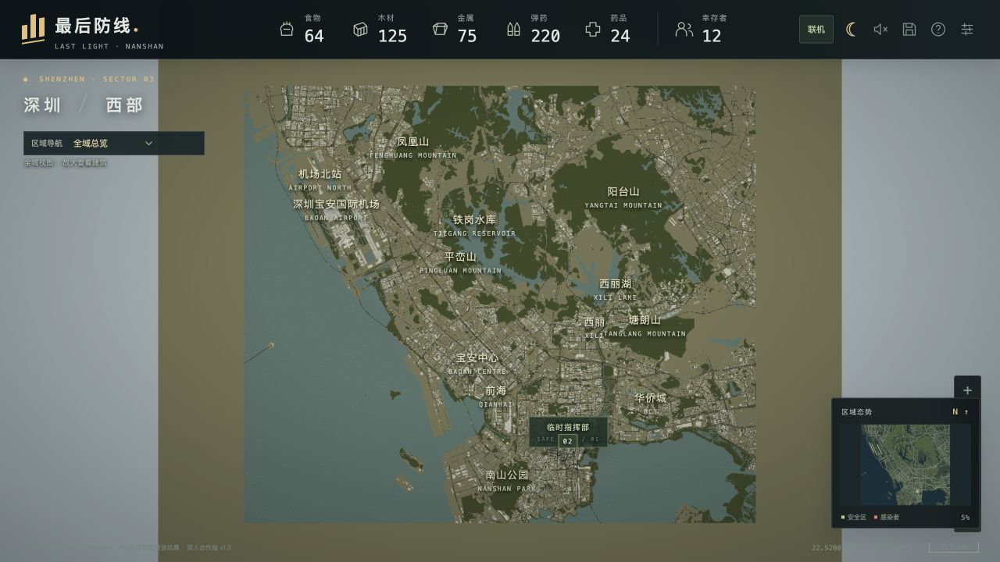

# 最后防线 · 深圳西部

[](https://github.com/nickliuuu/nanshan-last-light/actions/workflows/check.yml)



可直接玩的独立 3D 生存建造游戏原型。以深圳真实道路、建筑、水库和海岸线为地图，包含搜刮、建设、昼夜尸潮与双人合作。玩法参考《无感染区》（Infection Free Zone），模型和界面由本项目实现。

## v1.3：扩展地图 + 双人合作

- 按用户截图地标将范围扩展到南山、宝安、西丽、机场、凤凰山和阳台山一带，约 **763.5 平方公里**，原地图约 41.2 平方公里。
- 保留 **35,825 座建筑、42,054 段道路、4,365 个绿地等面要素、652 个机场设施要素**。全域总览与 14 个区域入口支持快速定位。按街区显示细节，远景使用简化建筑，避免同时绘制所有立面设备。
- 双人房间：房主控制 01 队，队友控制 02 队；共享物资、建筑、基地、敌人和时间。双方可搜刮、移动、治疗、建造和暂停；房主继续战局并调整倍速。
- 通过房间码加入。服务器中继指令并保存房主快照，通常每 400 毫秒一次同步，显示有少量网络延迟。已确认的指令编号保留去重；队友不能提交房主快照或控制一队。
- 房主需要保持游戏页面打开。失联后暂停，短暂网络中断自动重试；刷新同一标签页后，在合作面板点击“重连上次的合作房间”。重连后由房主继续。房间在最后一次主机同步后保留 24 小时；不是离线托管服务器，不支持房主迁移。
- 合作房间与单人存档独立。旧后海地图存档可以在扩展地图上继续，建筑 ID、基地位置及已有进度保留。

## 直接开始

线上地址：<https://nanshan-last-light-nick.nick-liu66.chatgpt.site>

网站的访问权限独立于游戏房间码。当前站点保持原有私密权限；队友需要站点访问权才能通过线上地址进入。房间码只用于加入已获访问权的游戏，不会改变网站权限。

本地需要 **Node.js 22.13 或更新版本**，推荐 24 LTS。本地游玩与局域网联机使用 Node 内置 SQLite，无须安装 npm 包。

- Mac 双击 `启动游戏.command`：仅本机服务，默认 <http://127.0.0.1:4173/>。
- Mac 双击 `启动联机.command`：开启局域网服务，终端显示队友应打开的地址；两人连接同一 Wi-Fi，队友打开终端中的局域网地址。
- 命令行：`npm run start:game` 或 `npm run lan`。若端口被占用，可用 `PORT=4180 npm run lan`。
- 不要直接双击 HTML 文件。浏览器会阻止本地文件的模块和地图数据加载。

两人进入后，一人点击 **联机 → 创建合作房间**，另一人点击 **联机 → 加入房间** 并输入 8 位房间码。房主确认双方连接后点击 **开始 / 继续合作行动**。

## 操作

| 操作 | 控制 |
|---|---|
| 平移 / 缩放 | 鼠标拖动 / 滚轮；WASD |
| 旋转 | Q / E；右键拖动 |
| 总览 / 回基地 | G / H；左上区域导航 |
| 暂停 / 继续 | 空格；合作继续由房主管理 |
| 选择小队 | 1 / 2；合作时只能选择自己的小队 |
| 搜刮 | 点建筑，再点“派遣搜刮” |
| 战术转移 | 右键空地 |
| 建造 / 旋转 / 取消 | 底部设施；3–8 / R / Esc |
| 地名 / 纯地图 / 俯视 | L / M / V |

基地 520 米范围内可建造设施，最多同时施工 3 处。先建警戒塔，补充农场与弹药工坊。19:00 尸潮出现，06:00 清晨结算。物资归队才入库，守住三个夜晚后可继续无尽模式。大地图允许探索外围区域，但路程按真实米制计算，远征会耗时；本版基地仍在后海，尚无车辆和分基地。

单人每 30 秒保存到当前浏览器，键名保持 `nanshan-last-light-v1`。浏览器、域名或端口不同意味着不同单人存档。合作房间保存在服务端；本地数据库位于 `.local-coop/rooms.sqlite`，不包含在源码包和发布产物内。

## 画面

建筑有程序化立面、窗框、窗台、破损窗面、阳台、女儿墙、屋顶设备；道路有沥青纹理、车道线、斑马线、路灯和废弃车辆。单位含头部、躯干、四肢及装备，感染者有步态动画。夜间包含窗灯、追踪探照灯、弹道、枪口闪光和泛光。右上角 ☾ 可进入独立夜战演练，退出恢复原行动；合作时需先退出房间。

均衡、高画质、流畅三档保留；流畅档关闭阴影与泛光。鼠标拖动已修正为地面跟随指针，旋转镜头和俯视同样适用。

## 地图数据和精度

- WGS84 边界：113.750–114.040°E / 22.480–22.710°N，约 29.82 × 25.60 km。根据截图可见地标估定范围，边缘不是逐像素配准，也不是行政区划。
- 2026-11-04 从 OpenStreetMap API 0.6 下载 120 个小范围 XML，再补齐公园关系。保留原后海数据；海岸按有向岸线构面，水域内岛屿保留。导航网格 20 米，预计算为二进制文件。
- 建筑有真实轮廓；高度优先使用标注高度或楼层，其余确定性估算。立面、物资、植被和剧情为游戏美术设计。
- **地形仍为平面**，无真实山体高程、卫星影像、建筑室内；建筑内洞、立交的三维结构等仍有简化。公园在真实位置显示绿地和树木。
- © [OpenStreetMap contributors](https://www.openstreetmap.org/copyright)，派生数据库遵循 [ODbL 1.0](https://opendatacommons.org/licenses/odbl/1-0/)。完整数据是 `public/game/data/nanshan.json`、它列出的 57 个 `region/*.json` 分块及 `region-nav.bin`；不能只复制清单文件。
- Three.js 0.170.0，MIT 许可见 `public/game/vendor/THREE-LICENSE.txt`。

重新生成数据需要 Python 3、Shapely 2 和 NumPy。`scripts/download_region.py` 下载并缓存 API 小块；`scripts/expand_map.py --input <OSM XML files...> --legacy data-source/nanshan-core-v1.json` 进行合并、裁切与栅格化。详情和统计见 `public/game/data/region-provenance.json`。旧 `prepare_map.py` 仅用于原始核心区，不是扩展版生成入口。

## 开发、发布和验证

游戏源文件位于 `public/game/`。`server/rooms.mjs` 同时用于本地 SQLite 中继和线上 Cloudflare D1；`app/api/coop/route.ts` 是线上 API。Sites 使用 Vinext 的标准构建集成，`.openai/hosting.json` 声明 `DB`；公开仓库已移除原站点的项目 ID，独立部署时需关联你自己的 Sites 项目。`dist/` 是生成物，勿直接编辑。

```sh
npm test
npm run check
# 只有构建线上 Worker 时需要安装依赖
npm ci
npm run build
```

数据库 schema 位于 `db/schema.ts`，迁移位于 `drizzle/`。本地轻量服务器自动应用迁移；Worker 预览需按 Sites 文档先应用 D1 本地迁移；线上由部署流程应用。

自动测试覆盖 16 项：旧存档兼容、扩展地理边界、海陆判断、鼠标方向、搜刮、施工、资源扣费、夜战、完整三夜通关、两玩家独立控制、指令去重、快照同步、权限校验与重连。另以两个实际浏览器标签页验证创建/加入、两队分别搜刮归队、共享物资、队友建塔、暂停与双方刷新重连；发布版 Worker + D1 本地环境验证房间 API。

当前仍为独立原型。未包含可驾驶车辆、室内战斗、复杂科技贸易、房主迁移或移动端双指手势。

## 仓库范围

包含完整游戏源码、可分发地图数据、数据生成脚本、测试、云端 Worker 和局域网服务。不会上传房间数据库、浏览器存档、登录凭证、依赖目录或本机构建缓存。公开仓库的独立部署不会连接作者的线上房间数据库。

原创源码尚未另行指定开源许可证；公开可读不等于额外授予使用许可。地图遵循 ODbL，Three.js 和 Sites 构建集成遵循各自附带的第三方许可证。
